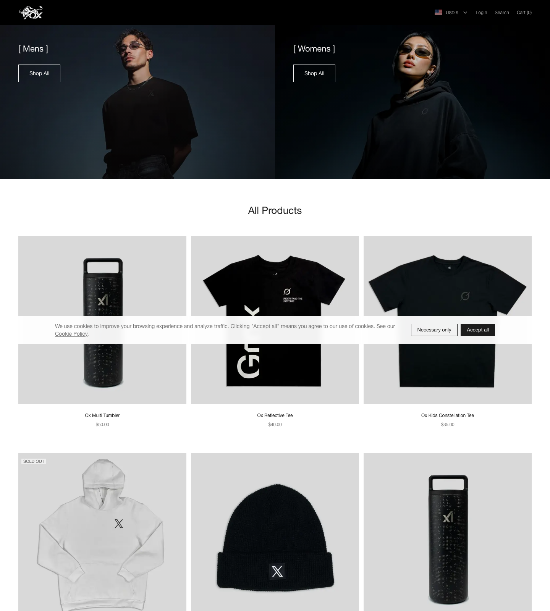
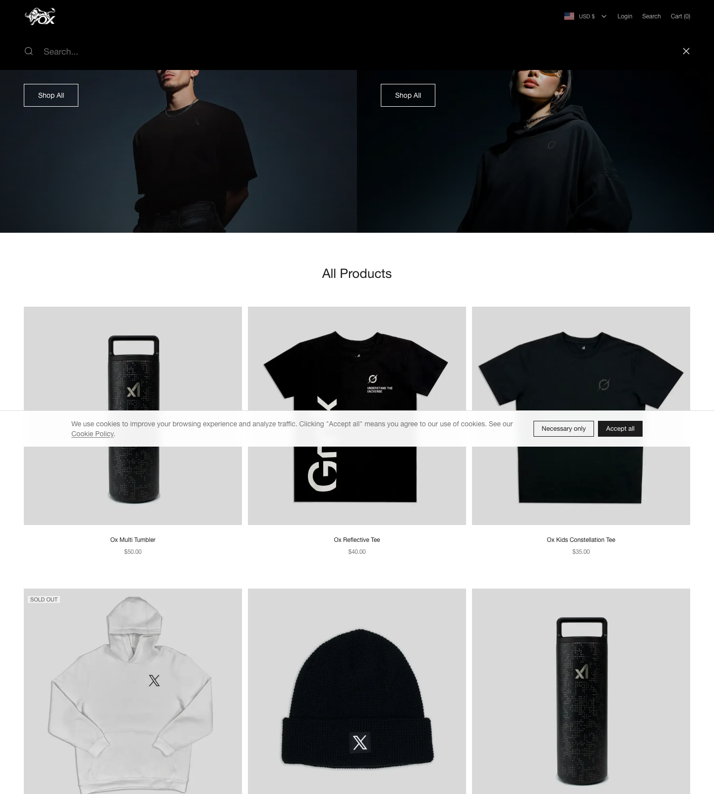
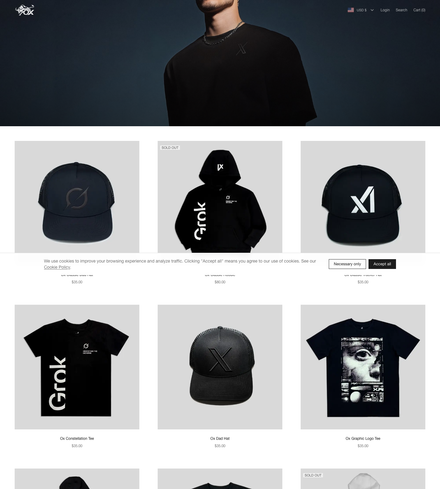
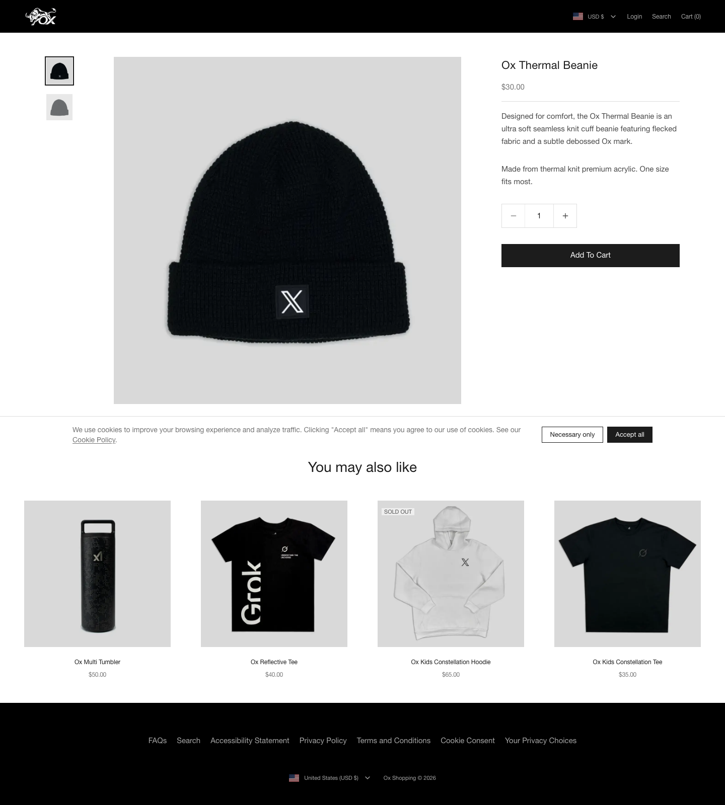

# Ox Shopping

> **生产级全栈电商独立站**：覆盖「浏览 → 加购 → 支付 → 发货 → 退款 → 通知」的完整商业闭环，内置管理后台、多币种、一键 Docker 演示与 8 道工序的 CI 门禁。

[](https://github.com/iMENGiCHAO/ox-shopping/actions/workflows/ci.yml)


面向商业交付，提供**本地一键演示**与**生产部署**两种模式。生产放量前必须通过 [当前能力矩阵](docs/CURRENT_CAPABILITY_MATRIX.md)、[商业交付手册](docs/COMMERCIAL_DELIVERY_RUNBOOK.md) 和上线自检；演示模式不等于生产收款能力。

---

## ✨ 核心特性

**🛒 商城前台** —— 黑白极简设计（0 圆角排版），交互细节见 [docs/DESIGN.md](docs/DESIGN.md)

- 完整购物链路：商品列表 / 商品详情 / 购物车侧滑抽屉 / 结算 / 订单跟踪 / 售后退款
- 多币种显示（9 种币种 + 实时汇率）、搜索弹层、商品卡 hover 双图切换 / 快速加购 / 色卡、详情图点击放大
- 站内通知 + 邮件通知双通道；政策页面、GDPR Cookie 横幅、数据删除请求入口
- 发票 PDF（pdfkit + 中文字体）、未支付订单自动过期

**🛠️ 管理后台** —— 独立设计令牌（`.admin-theme` 作用域，现代 SaaS 风格，前台零影响）

- 商品 / 分类 / 订单 / 用户 / 退款 / 审计 / 设置全模块管理，分类编辑内置落地页横幅（首页横幅由前两个分类驱动）
- **双向信息通知闭环**：前端动作（新订单 / 付款 / 退款 / 新用户 / 补货）自动进后台「消息中心」；后台处理（发货 / 退款 / 取消）自动邮件 + 站内通知客户
- 统一数据表规范（sticky 操作列 / 状态徽章不换行 / 长文本截断），侧栏可收起/展开
- ADMIN / SUPPORT 分级 RBAC，API 层与页面层双重校验

**🔐 安全与资金**

- 自建 JWT 认证：httpOnly Cookie + Refresh Token 轮换（重放检测）+ bcrypt(12) 密码哈希 + CSRF double-submit
- Stripe Checkout + Webhook 签名验证 + 事件幂等为当前真实收款通道；支付宝/微信/银行卡/PayPal 为预留接口；模拟支付仅用于本地演示
- 防超卖（下单事务内原子扣库存）、限流（Redis Lua 原子实现，可降级内存）、敏感操作审计日志、订单状态机校验

**⚙️ 工程化**

- Vitest 单元 + 集成测试、Playwright E2E 与视觉回归基线
- 8 道 CI 门禁：Lint/Typecheck + QA 静态门禁、依赖审计、空库迁移一致性、备份可恢复演练、测试、生产构建、Docker 冒烟、Compose 全栈冒烟
- Docker 多阶段构建 + docker-compose 一键起栈（Postgres / Redis / RustFS 对象存储 / 备份 sidecar）
- pino 结构化日志 + 请求 ID 追踪 + Sentry（可选，`SENTRY_DSN` 配置即启用）

---

## 🖼️ 界面预览

同一会话生产构建真实渲染，六张统一 **1440×1600** 规格（顶栏多币种切换 · hover 双图切换商品卡）：

| 首页 | 集合索引 | 搜索弹层 |
| :---: | :---: | :---: |
|  |  |  |
| 商品列表（PLP） | 商品详情（PDP） | 购物车空态 |
| :---: | :---: | :---: |
|  |  |  |

> 截图与 CI 视觉回归基线同源同风格；基线的采集与更新流程见 [docs/testing.md](docs/testing.md)。后台界面截图见 [docs/admin-guide.md](docs/admin-guide.md)（九张统一 1440×900 规格）。

---

## 📚 文档导航

| 想做什么 | 看哪份 |
| --- | --- |
| 了解架构与数据模型（组件图 / ER 图 / 认证机制） | [docs/architecture.md](docs/architecture.md) |
| 参与开发（目录职责 / 数据库工作流 / 常见任务配方） | [docs/development.md](docs/development.md) |
| 跑测试 / 更新视觉回归基线 | [docs/testing.md](docs/testing.md) |
| 部署生产（必填变量表 / 备份演练 / Nginx） | [docs/deployment.md](docs/deployment.md) |
| 使用管理后台（26 个页面图文手册） | [docs/admin-guide.md](docs/admin-guide.md) |
| 接入 Stripe 真实收款 | [docs/payment-channels.md](docs/payment-channels.md) |

---

## 🧰 技术栈

| 层 | 选型 |
| --- | --- |
| 框架 | Next.js 16（App Router，Turbopack）+ React 19 + TypeScript（严格模式） |
| 样式 | Tailwind CSS + shadcn/ui（Radix UI） |
| 数据库 | PostgreSQL 16 + Prisma ORM（版本化迁移历史） |
| 缓存/限流 | Redis（ioredis，可通过环境变量关闭，自动降级内存实现） |
| 支付 | Stripe Checkout + Webhook；模拟支付仅本地演示 |
| 邮件 | Resend / Nodemailer SMTP / 控制台（未配置时打印日志并落盘 `.mail-out/`），模板 react-email |
| 文件存储 | S3 兼容（AWS S3 / Cloudflare R2 / MinIO，预签名上传）；本地磁盘仅开发/演示 |
| 验证 | Zod（请求与表单） |
| 测试 | Vitest（单元 + 集成）+ Playwright（E2E + 视觉回归） |
| 部署 | Docker 多阶段构建 + docker-compose + Nginx + GitHub Actions CI |
| 日志/监控 | pino 结构化日志 + 请求 ID 追踪；Sentry 可选 |

---

## 目录结构

```
ecommerce/
├── src/
│   ├── app/                    # App Router
│   │   ├── (shop)/             # 用户端（首页/商品/购物车/结算/订单/个人中心/认证/政策）
│   │   ├── admin/              # 管理端（仪表盘/商品/分类/订单/用户/退款/审计/设置）
│   │   ├── api/                # 全部 API Route Handlers
│   │   ├── globals.css
│   │   ├── layout.tsx
│   │   └── healthz/route.ts    # 健康检查
│   ├── components/
│   │   ├── ui/                 # shadcn/ui 基础组件
│   │   ├── shop/               # 商城组件
│   │   └── admin/              # 管理端组件
│   ├── emails/                 # react-email 邮件模板
│   ├── lib/                    # 认证/数据库/缓存/邮件/支付/存储/日志/校验/工具
│   ├── server/services/        # 业务逻辑（订单事务、购物车、商品、统计）
│   ├── proxy.ts                # 请求ID / CSP / CSRF / admin 守卫（Next 16 中间件约定）
│   └── types/
├── prisma/                     # schema + 种子数据
├── public/fonts/               # 发票中文字体（Noto Sans CJK，OFL 协议）
├── deploy/nginx.conf           # 生产 Nginx 配置
├── scripts/wait-for-db.mjs     # 容器启动等待数据库
├── tests/                      # unit / integration / e2e
├── docker-compose.yml
├── Dockerfile
└── .github/workflows/ci.yml
```

---

## 一键启动（推荐：Docker）

前置：安装 Docker + Docker Compose（本仓库在 macOS / Linux 上验证）。

本地演示（模拟支付 + RustFS 对象存储 + 种子数据，无需任何环境变量）：

```bash
docker compose -f docker-compose.yml -f docker-compose.local.yml up -d --build
```

生产部署（严格模式：密钥必须来自 `.env`，缺失即拒绝启动）：

```bash
cp .env.example .env   # 填写 SITE_URL / POSTGRES_PASSWORD / JWT_* 等必填项
docker compose up -d --build
```

首次启动会自动：创建 Postgres/Redis/RustFS 容器 → 等待数据库就绪 → 执行 Prisma 迁移 → （本地演示）写入种子数据 → 启动应用。
生产容器默认**不执行种子**（`SEED_ON_START=false`），运营数据不会被重置。

| 服务                       | 地址                                             |
| -------------------------- | ------------------------------------------------ |
| 商城前台                   | http://localhost:3000                            |
| 管理后台                   | http://localhost:3000/admin                      |
| RustFS 控制台（仅本地演示） | http://localhost:9001（minioadmin / minioadmin） |

**种子账号**（密码均为对应 `@123456` 形式）：

| 角色          | 邮箱                | 密码           |
| ------------- | ------------------- | -------------- |
| 管理员 ADMIN  | admin@example.com   | Admin@123456   |
| 顾客 CUSTOMER | user@example.com    | User@123456    |
| 客服 SUPPORT  | support@example.com | Support@123456 |

本地演示覆盖文件使用**模拟支付**与**控制台邮件**，用于验证下单→支付→发货→退款链路。生产环境不会自动降级到免费模拟支付；真实上线必须配置可用支付、邮件和对象存储，并通过 `/admin/launch-readiness` 与 `npm run preflight`。

---

## 本地开发（不使用 Docker）

```bash
# 1. 准备 PostgreSQL 16 + Redis（可仅用 Postgres，Redis 可关）
brew install postgresql@16 redis && brew services start postgresql@16 && brew services start redis

# 2. 创建数据库
createdb ecommerce
createdb ecommerce_test   # 集成测试用

# 3. 安装依赖（postinstall 自动 prisma generate）
npm install

# 4. 环境变量
cp .env.example .env      # 按需修改；默认值即可跑通（mock 支付 + console 邮件 + 本地存储）

# 5. 数据库迁移 + 种子
npx prisma db push        # 或 npx prisma migrate dev（需交互命名迁移）
npm run db:seed

# 6. 启动
npm run dev               # http://localhost:3000
```

> 说明：仓库已内置**持续演进的版本化迁移历史**（`prisma/migrations/` 目录，覆盖订单/支付渠道/分销/优惠券/COD 等业务模块，具体以目录为准，勿在文档里写死数量）。生产/CI 用 `prisma migrate deploy` 应用历史迁移；开发快速迭代可用 `prisma db push` 同步 schema；新增结构变更用 `npx prisma migrate dev --name <名称>` 生成并提交新迁移。

---

## 环境变量参考

完整注释见 [`.env.example`](./.env.example)。核心项：

| 变量                                                                                                                | 默认                          | 说明                                                                     |
| ------------------------------------------------------------------------------------------------------------------- | ----------------------------- | ------------------------------------------------------------------------ |
| `DATABASE_URL`                                                                                                      | 本地 ecommerce 库             | PostgreSQL 连接串                                                        |
| `REDIS_URL` / `REDIS_ENABLED`                                                                                       | redis://localhost:6379 / true | 缓存与限流；关闭后降级内存实现                                           |
| `JWT_ACCESS_SECRET` / `JWT_REFRESH_SECRET`                                                                          | dev 值                        | **生产必须替换**：`openssl rand -base64 48`                              |
| `ACCESS_TOKEN_TTL` / `REFRESH_TOKEN_TTL`                                                                            | 900 / 604800                  | 15 分钟 / 7 天                                                           |
| `PAYMENT_MODE`                                                                                                      | auto                          | `auto`/`stripe`/`mock`；未配置 Stripe 密钥时自动 mock                    |
| `STRIPE_SECRET_KEY` / `STRIPE_WEBHOOK_SECRET`                                                                       | 空                            | Stripe 密钥与 Webhook 签名密钥                                           |
| `CURRENCY`                                                                                                          | USD                           | 基础币种。**注意：Stripe 不支持 CNY**，启用 Stripe 时保持 USD 等支持币种 |
| `MAIL_PROVIDER`                                                                                                     | console                       | `resend` / `smtp` / `console`（console 打印日志并落盘 `.mail-out/`）     |
| `RESEND_API_KEY` / `SMTP_*`                                                                                         | 空                            | 邮件服务配置                                                             |
| `STORAGE_DRIVER`                                                                                                    | local                         | `s3` / `local`；S3 兼容（AWS S3/R2/MinIO）                               |
| `S3_ENDPOINT` / `S3_BUCKET` / `S3_ACCESS_KEY_ID` / `S3_SECRET_ACCESS_KEY` / `S3_PUBLIC_URL` / `S3_FORCE_PATH_STYLE` | —                             | 对象存储；`S3_PUBLIC_URL` 为浏览器访问前缀                               |
| `UPLOAD_MAX_BYTES`                                                                                                  | 10485760                      | 上传大小上限（10MB）                                                     |
| `SHIPPING_FEE` / `FREE_SHIPPING_THRESHOLD` / `TAX_RATE`                                                             | 10 / 99 / 0                   | 运费、满额包邮、税率                                                     |
| `ORDER_EXPIRE_SECONDS`                                                                                              | 1800                          | 未支付订单自动取消（读取订单列表时惰性触发）                             |
| `SENTRY_DSN`                                                                                                        | 空                            | 配置后启用异常上报                                                       |
| `LOG_LEVEL`                                                                                                         | info                          | pino 日志级别                                                            |

---

## Stripe 测试配置（从模拟支付切换）

1. 注册 [Stripe](https://stripe.com) 测试环境，获取 `sk_test_...`。
2. `.env`（或 docker-compose app 服务的环境）中设置：

   ```bash
   PAYMENT_MODE=stripe        # 或 auto
   STRIPE_SECRET_KEY=sk_test_xxx
   STRIPE_WEBHOOK_SECRET=whsec_xxx
   CURRENCY=USD               # Stripe 不支持 CNY，必须换币种
   ```

3. Webhook 本地调试（模拟支付可直接跳过）：

   ```bash
   stripe listen --forward-to localhost:3000/api/webhooks/stripe
   # 或 docker：
   stripe listen --forward-to host.docker.internal:3000/api/webhooks/stripe
   ```

   监听事件：`checkout.session.completed`、`payment_intent.payment_failed`、`charge.refunded`。将 `whsec_` 填入 `STRIPE_WEBHOOK_SECRET`。

4. 测试卡号：`4242 4242 4242 4242`（任意未来日期/CVC）。

Webhook 会验证签名（签名错误返回 400）；事件处理幂等（重复事件不会重复发货/重复入账）。

---

## 测试

```bash
npm run test:unit          # 单元测试（无需数据库）
npm run test:integration   # 集成测试（需要 PostgreSQL，.env.test 中 DATABASE_URL）
npm run test:e2e           # E2E（需要 dev 服务器 + 种子数据库）
```

- **单元测试**：金额转换、密码强度、订单状态机、Zod 校验、工具函数。
- **集成测试**：直接调用 Route Handler（无需启动服务器），覆盖认证全流程、CSRF 中间件、RBAC、商品列表、购物车、下单锁库存、模拟支付、发票、退款审批、审计日志。`global-setup` 自动对 `DATABASE_URL` 执行 `prisma db push` + `db seed`。
- **E2E**（Playwright）：注册/登录/登出、浏览→加购→结算→模拟支付→订单确认、管理端登录与商品创建。

```bash
# 首次运行 E2E 需安装浏览器
npx playwright install chromium
# 启动依赖（任选其一）
docker compose up -d postgres redis rustfs rustfs-init
# 或本地 brew 服务 + 种子数据
npm run test:e2e
```

---

## 部署（生产）

### Docker Compose 单机

```bash
# 1. 修改 docker-compose.yml 中 app 服务的环境变量（密钥、SITE_URL、Stripe、邮件等）
# 2. 构建并启动
docker compose up -d --build
```

### Nginx + HTTPS（前端反代）

`deploy/nginx.conf` 提供完整配置（SSL 终止、HTTP→HTTPS 跳转、安全头、静态资源缓存、gzip）。将域名替换为你的域名，SSL 证书可用 certbot 申请：

```bash
sudo apt install certbot
sudo certbot certonly --standalone -d shop.example.com
# 将证书软链到 /etc/nginx/ssl/{fullchain,privkey}.pem 后 reload
```

若 app 与 Nginx 同机不同容器，upstream 指向 `app:3000`（同 compose 网络）；宿主机部署则改 `127.0.0.1:3000`。

### CI/CD（GitHub Actions）

`.github/workflows/ci.yml` 包含八个任务：**Lint & Typecheck + QA 静态门禁**（硬编码/错误文案/死链）、**依赖审计**（运行时依赖 high 阻断）、**迁移一致性门禁**（空库 deploy + 与 schema 的 drift 比对）、**单元+集成测试**（Postgres/Redis 服务容器，自动迁移+种子）、**生产构建**、**Playwright E2E**、**Docker 镜像冒烟**、**Docker Compose 全栈冒烟**。推送到 `main` 自动执行。

### 生产检查清单

- [ ] 替换 `JWT_ACCESS_SECRET` / `JWT_REFRESH_SECRET`（`openssl rand -base64 48`）
- [ ] 设置 `SITE_URL` 为 https 域名（影响 Cookie Secure、邮件链接、支付回调）
- [ ] 配置 Stripe 密钥与 Webhook；`CURRENCY` 使用 Stripe 支持币种
- [ ] 配置邮件（Resend 或 SMTP）
- [ ] 配置对象存储桶（公开读或 CDN 前缀 `S3_PUBLIC_URL`）
- [ ] `COOKIE_DOMAIN` 若需跨子域共享会话
- [ ] 配置 `SENTRY_DSN`（可选）
- [ ] 数据备份：Postgres 卷 `pgdata`（`docker compose exec postgres pg_dump ...`）

---

## 安全设计

- 密码 bcrypt(12) 哈希 + 强度校验（大小写+数字，≥8 位）
- Access Token（httpOnly/Secure/SameSite=Lax，15 分钟）+ Refresh Token 轮换（DB 存哈希、重放检测：检测到重放立即吊销该用户全部会话）
- CSRF double-submit cookie（中间件强制校验变更请求，Webhook 豁免）
- 限流：登录 5 次/分/IP+邮箱、注册/找回 3 次/分/IP（Redis 或内存降级）
- 安全响应头：CSP / X-Frame-Options / nosniff / Referrer-Policy / Permissions-Policy（Stripe 域名白名单）
- 防超卖：下单事务内 `UPDATE ... WHERE stock >= qty` 原子扣减
- 防 SQL 注入：Prisma 参数化查询；防 XSS：React 转义 + DOMPurify 服务端净化富文本
- 文件上传：MIME 白名单 + 大小限制 + 随机文件名 + S3 预签名
- Webhook 签名验证；订单状态机校验非法流转；敏感操作审计日志
- 管理端 RBAC：ADMIN / SUPPORT 分级；API 层与页面层双重校验

## 常见问题（FAQ）

**Q：不配置 Stripe/Resend/S3 能跑吗？**
能。支付降级为模拟支付（站内确认页），邮件打印到日志并落盘 `.mail-out/`，文件保存到本地 `storage/` 并经 `/api/uploads/...` 提供访问。

**Q：`docker compose up` 后 3000 端口打不开？**
查看容器日志 `docker compose logs -f app`。常见原因：端口占用（改 `ports` 映射）、首次构建慢（耐心等待 healthcheck `start_period` 40s）。

**Q：Stripe 报错 “currency CNY not supported”？**
Stripe 不支持人民币。将 `CURRENCY=USD`（或其他 Stripe 支持币种），或保持 `PAYMENT_MODE=mock`。

**Q：上传的图片 404？**
本地模式确认 `STORAGE_DRIVER=local`；S3/RustFS 模式确认 `S3_PUBLIC_URL` 前缀正确且桶公开读（compose 中 rustfs-init 已自动设置）。RustFS 控制台在 9001 端口。

**Q：邮件收不到？**
默认 `MAIL_PROVIDER=console`：查看 app 日志中的 `[mock-mail]` 行或 `.mail-out/` 目录的 HTML。改用 Resend/SMTP 时确认密钥与发件人域名验证。

**Q：集成测试报 “无法连接测试数据库”？**
启动 Postgres 并创建 `ecommerce_test` 库（或修改 `.env.test` 的 `DATABASE_URL`）。只想跑单元测试用 `npm run test:unit`。

**Q：如何新增商品图片上传到 MinIO？**
管理端商品表单内置上传组件：S3 模式自动走预签名 PUT，本地模式走直传。存储桶/密钥在环境变量中配置。

**Q：忘记管理员密码？**
本地：`npm run db:studio` 打开 Prisma Studio 查看/修改；或重置 `users` 表 `passwordHash`（可用 `node -e "console.log(require('bcryptjs').hashSync('新密码',12))"` 生成）。

## 许可证与第三方资产

仓库根目录当前未包含由版权所有人选择的开源许可证，因此**在添加明确 `LICENSE` 前，不应默认转售、分发或授予第三方使用权**。发票 PDF 使用的 Noto Sans CJK 字体遵循 [SIL Open Font License 1.1](https://scripts.sil.org/OFL)。商品图、品牌素材及参考站相关资产的授权边界见 [NOTICE.md](NOTICE.md)；商业交付前必须由资产权利人确认并替换无授权素材。

---

## 商业化交付硬化（Engineering Hardening）

本项目已经过系统性硬化，覆盖：CSRF / admin 守卫 / 退款事务 / 状态机 / 限流 / sanitize / 多币种 / i18n / 品牌打通 / 死代码清理 / 死循环 bug 修复。

完整变更记录见 [CHANGELOG.md](CHANGELOG.md)，本轮商业交付前的证据化审计见 [PROJECT_AUDIT_2026-09-23.md](docs/PROJECT_AUDIT_2026-09-23.md)。下面是按“严重度”分层的快速索引：

### 一句话总结

- 安全：CSRF double-submit + /admin 守卫 + Stripe 退款 + 行锁 + sanitize 全链路 + Redis Lua 原子限流
- 资金：退款事务全状态计入 + 状态机硬化 + 整单退款走 `refundEntireOrder`（Stripe + 库存回补 + 邮件 + audit）
- 体验：mock-pay 真实状态校验 / 灯箱黑底 / 多币种 locale 修正 / 品牌资源统一

### 部署前必须检查

- `JWT_ACCESS_SECRET` / `JWT_REFRESH_SECRET` ≥ 32 位随机串（`openssl rand -base64 48`）
- `CURRENCY` 在白名单内（`USD EUR GBP JPY HKD CNY AUD CAD SGD`）
- `REQUIRE_STRONG_SECRETS=true`（生产默认）
- `INVOICE_FONT_PATH`（可选，未配置时用 `public/fonts/NotoSansCJKsc-Regular.otf`）
- 邮件 `MAIL_FROM` 用自家域名（`MAIL_FROM="Ox Shopping <no-reply@yourdomain.com>"`）
- Stripe `STRIPE_WEBHOOK_SECRET` 必须在 Stripe Dashboard 创建 webhook 并复制签名密钥

---

[](https://github.com/deepseek-ai/deepseek-harness)
