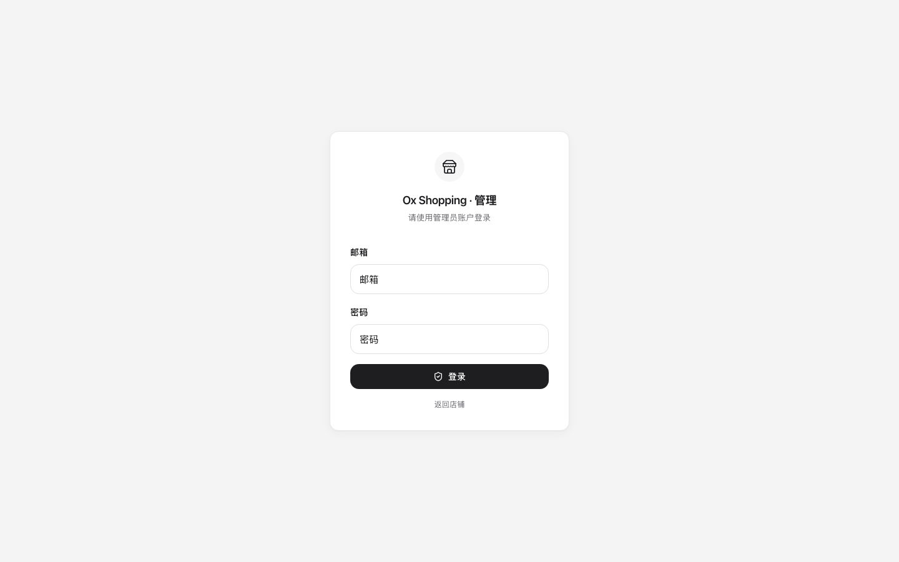
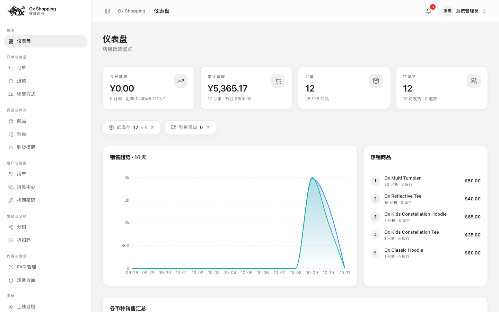
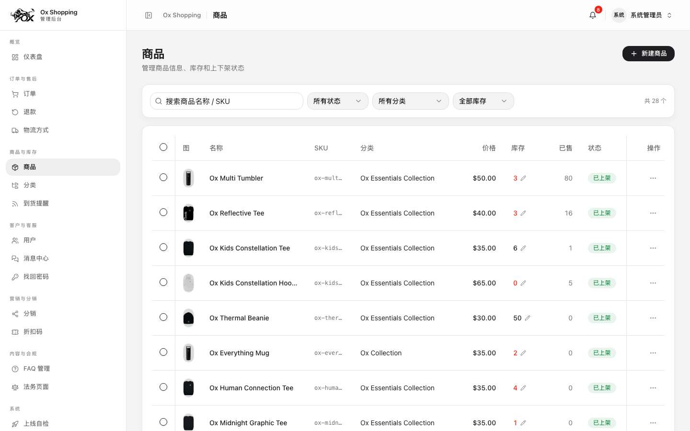
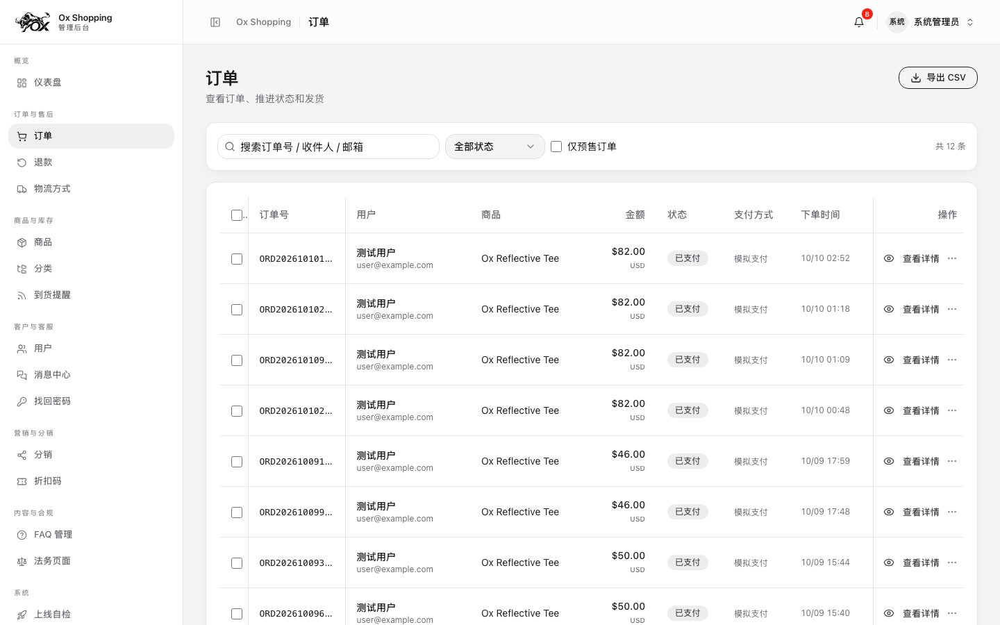
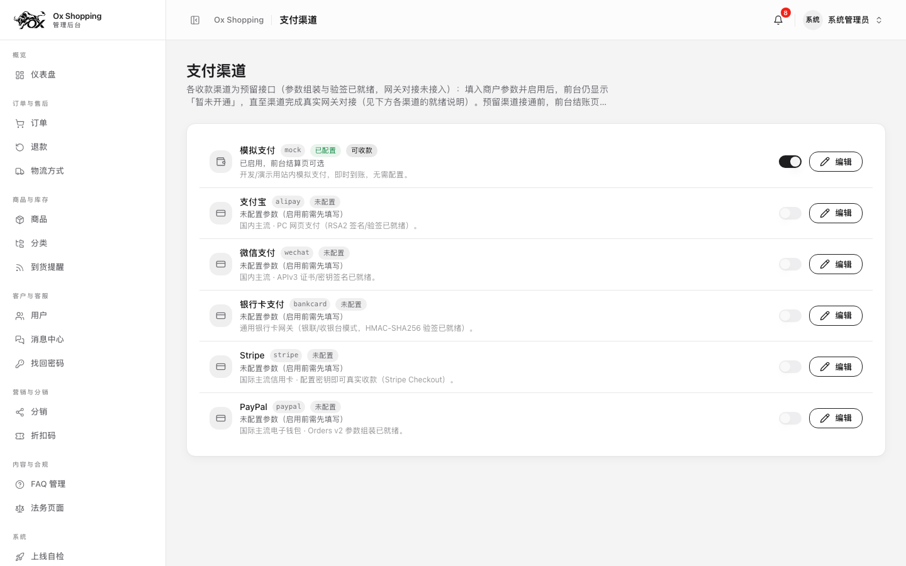
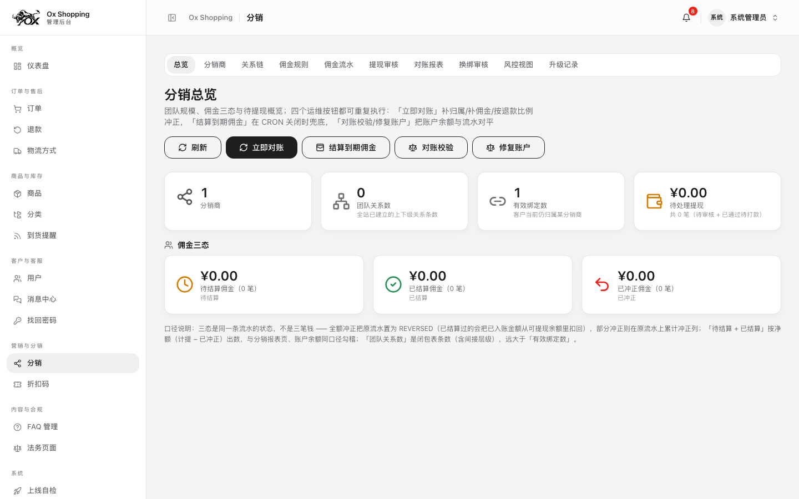
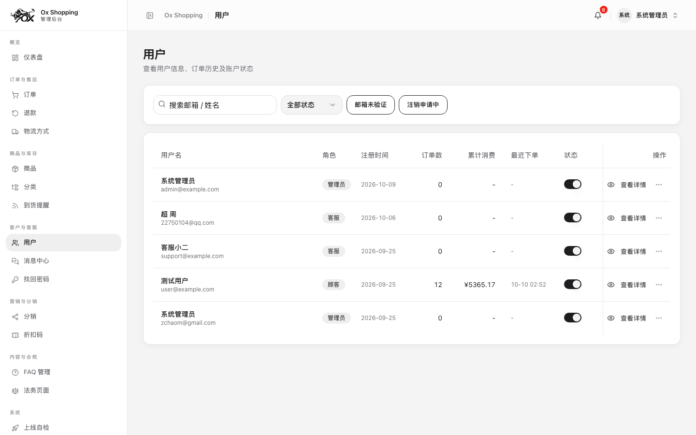
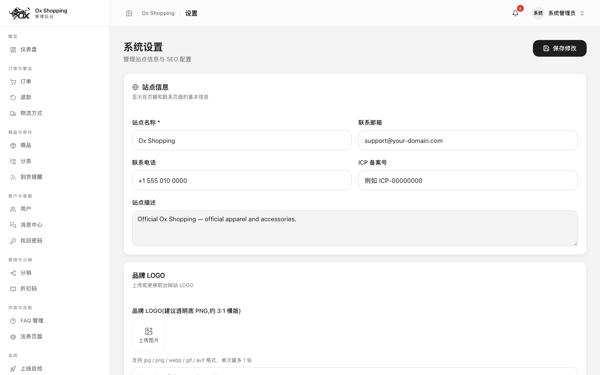
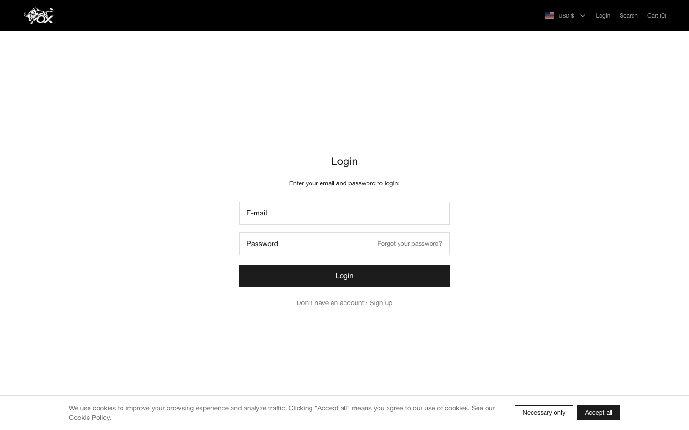

# 🖥️ 管理后台使用手册

> 截图取自真实生产模式渲染（种子数据），点击任何一张可看大图。后台共 26 个页面，本文按日常工作频率讲最重要的 8 块。

## 登录

- 地址：`/admin/login`，与前台登录（`/auth/login`）**完全分离**——后台泄露不影响前台账号体系。
- 本地演示种子账号：`admin@example.com / Admin@123456`（生产不种子，用 `npm run admin:create` 建号）。
- 忘记密码不走自助邮件直发：管理员审批发放**一次性临时密码**，首登被强制改密（防弱凭证沉淀为长期凭证）。
- 所有登录尝试有防爆破限流。

## 仪表盘

进入 `/admin` 即运营总览：销售/订单/用户核心指标、待处理事项（待发货、退款申请、找回密码审批）。

## 商品管理

`/admin/products`：商品列表 → 编辑器管理多规格 SKU 变体（价格、库存、条码）。要点：

- **库存一致性**：库存挂在 SKU 变体上，订单/购物车只引用变体——套装组合也统一走变体链路，不会出现两处库存对不上。
- **预售语义**：商品状态含独立 Pre-order 语义，与「无库存」严格区分。
- 类目树（`/admin/categories`）支持拖拽排序，前台导航自动跟随。

## 订单

`/admin/orders`：订单全生命周期（创建 → 支付 → 发货 → 完成/退款）。退款走独立审批流并经 `refund_outbox` 可靠执行；每次状态变更落 `audit_logs`。`/admin/refunds` 处理退款申请，`/admin/shipping` 配置运费模板。

## 支付渠道

`/admin/payment-channels`：渠道化设计——Stripe 与模拟支付是并列的「渠道」，不是全局开关。

- Stripe 密钥以 `PAYMENT_CHANNEL_ENC_KEY` AES 加密落库，页面上**永远只显示掩码**。
- 渠道变更（启用/换钥）留痕审计，出问题可回溯是谁在何时改的。
- 接入步骤见 [payment-channels.md](payment-channels.md)。

## 分销体系

`/admin/distribution` 是一个功能组（左侧 7 个子页）：关系链、客户绑定、佣金结算、提现审批、促销规则、风控、报表。佣金对账走数据库事务 + 对账任务（`reconcile`），提现打款前有人工审批位。

## 用户管理

`/admin/users`：角色（ADMIN / 用户 / 客服…）、状态（ACTIVE/封禁）、邮箱验证。敏感操作（改角色、封禁）落审计日志。`/admin/password-resets` 审批找回密码申请并发放临时密码；`/admin/audit-logs` 可查所有后台敏感动作的完整流水。

## 站点设置

`/admin/settings`：品牌名、默认货币、站点级参数。周边页面：

- `/admin/legal` 法务页面**独立编辑器**（隐私政策/服务条款可整页富文本）
- `/admin/faqs` FAQ 管理（有默认种子文案 `src/lib/faq-defaults.ts`）
- `/admin/notify-me` 缺货到货通知登记；`/admin/notifications` 站内通知
- `/admin/coupons` 优惠券（满减/比例，核销记录落 `coupon_redemptions`）
- `/admin/launch-readiness` 上线前自检清单页

## 前台账号

顾客在 `/auth/login` 登录（与后台隔离）。登录后可管理收货地址、查看订单、发起退款；邮箱验证与找回密码邮件由 `mail_outbox` 可靠投递。

## 截图版权说明

本手册截图取自本项目种子数据与真实 UI 渲染，界面资产遵循 [NOTICE](../NOTICE.md) 声明。
