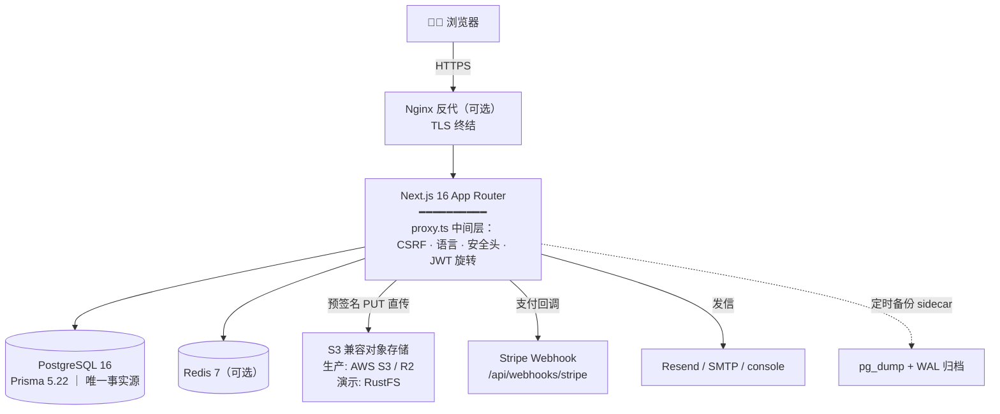
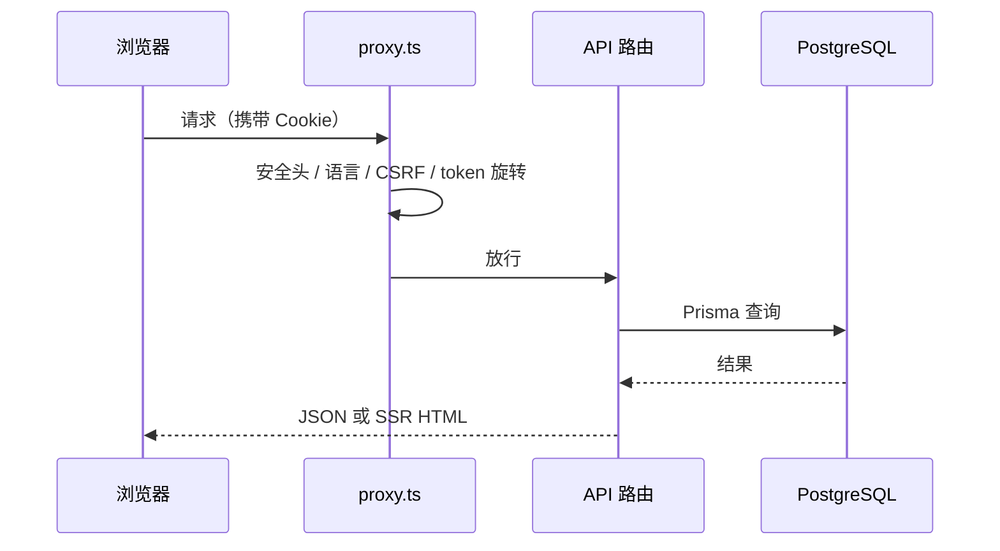
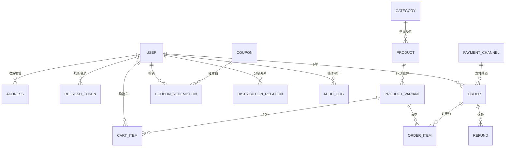
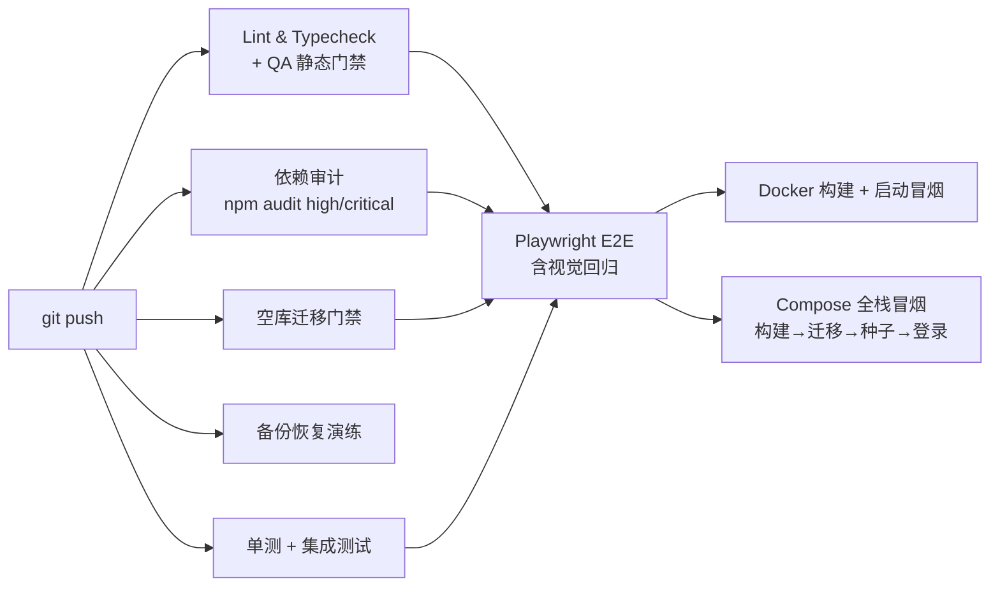

# 🏗️ 架构说明

> 阅读前提：你已看过 [README](../README.md) 并成功把项目跑起来。本文解释**它为什么长这样**。

## 1. 技术形态

Next.js 16 App Router 全栈单体——**没有独立的 API 服务**：页面（SSR/RSC）与接口（`/api/*`）同进程渲染，由统一的 `proxy.ts` 中间层收口安全与横切逻辑。数据层用 Prisma 直连 PostgreSQL；Redis 为可选加速件；对象存储用 S3 兼容协议（生产 AWS S3 / Cloudflare R2，本地演示 RustFS）。

```
浏览器 ──(可选 Nginx/TLS)──▶ Next.js 单体 ──┬──▶ PostgreSQL 16（唯一事实源）
                                            ├──▶ Redis（可选）
                                            ├──▶ S3 兼容对象存储
                                            ├──▶ Stripe（Webhook 回调）
                                            └──▶ Resend / SMTP（事务邮件）
```

### 组件关系



## 2. 请求生命周期

所有请求先过 `src/proxy.ts`（Next.js Middleware），它按顺序做：

1. **安全响应头**（CSP nonce、HSTS 等）
2. **多语言**：按 cookie/路径识别语言，错误文案经 `error-i18n` 本地化（所以代码里不允许硬编码中文错误文案，QA 门禁会拦）
3. **CSRF**：`GET /api/*` 自动下发 `csrf_token` cookie；`POST/PUT/PATCH/DELETE` 做**双提交校验**——请求头 `x-csrf-token` 必须与 cookie 同值且 ≥32 字符
4. **JWT 旋转**：access token 过期但 refresh token 有效时，透明换发新 token 对（滑动续期）
5. **强制改密门控**：临时密码首登后，用户被钉在改密页完成改密



## 3. 认证与安全设计

| 机制 | 设计 | 参数 |
| --- | --- | --- |
| 密码散列 | bcryptjs | — |
| 双 token | access + refresh，均为 HttpOnly Cookie | access 15 分钟（900s）/ refresh 7 天（604800s），可用环境变量覆盖 |
| CSRF | 无状态双提交（cookie === header） | 生产 cookie 带 `Secure` 标志 |
| 密钥强度门禁 | `REQUIRE_STRONG_SECRETS=true`（生产默认）时 JWT/渠道加密密钥必须 ≥32 位，否则**拒绝启动** | 本地演示显式设 `false` 跳过 |
| 登录/防爆破 | 登录接口限流；找回密码走管理员审批 + 一次性临时密码 + 强制改密 | — |
| 审计 | `audit_logs` 表记录后台敏感操作 | — |

**支付渠道加密**：Stripe 密钥经 `PAYMENT_CHANNEL_ENC_KEY`（AES）加密落库，数据库泄露不等于支付密钥泄露。详见 [payment-channels.md](payment-channels.md)。

**支付模式守卫**：`PAYMENT_MODE` 取 `auto / stripe / mock`。生产环境若漏配 Stripe 密钥或误设 `mock`（真实收款为 0）会在**启动时被拒绝**——宁可不上线也不裸奔。

## 4. 核心数据模型

完整定义见 [prisma/schema.prisma](../prisma/schema.prisma)（模型用 `@@map` 映射为 snake_case 表名）。核心交易闭环：



### 库存一致性（供应链语义）

库存行挂在 **SKU 变体**上，订单/购物车只引用变体。2026-09 起组合粒度（套装）统一走同一套变体链路，预售（Pre-order）有独立状态语义，`OrderStatus` / `ProductStatus` 枚举见 schema。

### Outbox 模式（可靠异步）

三个 outbox 表保证「必达」副作用在数据库事务内先落库、再由后台任务可靠投递：

| Outbox 表 | 职责 |
| --- | --- |
| `mail_outbox` | 事务邮件（订单确认、找回密码…） |
| `refund_outbox` | 退款执行/通知 |
| `webhook_event` | 对外 Webhook 重试 |

## 5. 对象存储

上传走 **S3 预签名 PUT 直传**（客户端不经应用服务器中转），桶配置公开读后 `S3_PUBLIC_URL` 直接作为图床。`STORAGE_DRIVER=local` 时文件落本地磁盘，仅限开发/演示。

## 6. CI 流水线（9 道门禁）

`.github/workflows/ci.yml`，push 到 main 触发：



任一失败即整条流水线红；Docker/Compose 两道冒烟**首次推送到 GitHub 时才真正执行**，本仓库为此清了一轮镜像与种子链路的坑（见 [CHANGELOG](../CHANGELOG.md) 2026-10-10 条目）。

## 7. 目录职责速览

```
src/
├── app/            # 页面与 API 路由（App Router：/shop 前台、/admin 后台、/api 接口）
├── components/     # UI 组件（shop 前台 / admin 后台 / 通用）
├── lib/           # 领域逻辑（auth、payment、db、api 封装、env 校验）
├── server/        # 仅服务端使用的模块（禁止被客户端引入）
├── emails/         # 邮件模板
├── proxy.ts        # 中间层：安全头 / CSRF / JWT 旋转 / 语言
└── instrumentation.ts  # 进程启动钩子（含生产密钥强度守卫）
```

逐目录说明与开发工作流见 [开发指南](development.md)。
